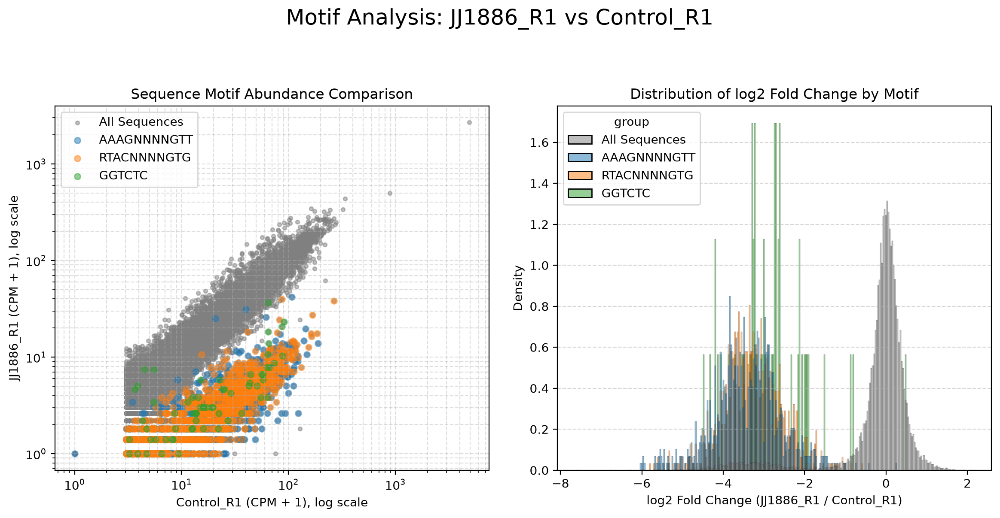

# randseq


<!-- WARNING: THIS FILE WAS AUTOGENERATED! DO NOT EDIT! -->

## Installation

Install latest from the GitHub [repository](https://github.com/dbikard/randseq):

``` sh
$ pip install git+https://github.com/dbikard/randseq.git
```

Optionally, with a compiled scan that is about 13x faster on 8 cores and gives identical results:

``` sh
$ pip install "randseq[fast] @ git+https://github.com/dbikard/randseq.git"
```

## Usage

RandSeq conjugates a library of plasmids with random inserts from a donor into a recipient strain
and counts each plasmid on both sides. A plasmid that carries a site the recipient’s defences
recognise is lost. The example here, `counts_panel.csv.gz`, is a library of 150 nt random inserts
counted in the donor (two replicates, `Control_R1` and `Control_R2`) and in 8 recipient strains in
two replicates each; `counts_panel_key.csv` says what each strain shows.

``` python
from randseq import calculate_log2fc, find_restricted_motifs, plot_motif_analysis, get_example_data_dir
import pandas as pd
```

``` python
# Read counts per plasmid: the donor library and 8 recipient strains, two replicates each
counts = pd.read_csv(os.path.join(get_example_data_dir(), "counts_panel.csv.gz"), index_col=0)
left, right = "GTCTAGGGCGGCGGTAAAAC", "ACTAGAGCACCAGAAGTCTA"   # vector sequence flanking the insert

# log2 fold change of each plasmid in each sample, against the first donor replicate
log2fc_df = calculate_log2fc(counts, reference_column="Control_R1")
```

[`find_restricted_motifs`](https://dbikard.github.io/randseq/core.html#find_restricted_motifs) searches one sample’s log2 fold changes for the motifs whose carriers
are depleted. It prints a log of its steps (not shown here) and returns the motifs it calls, in five
columns. For JJ1886 these are its three restriction-modification sites, the Type I site written as
one degenerate motif, `RTACNNNNGTG`:

``` python
motifs = find_restricted_motifs(log2fc_df["JJ1886_R1"], left, right)
```

``` python
motifs
```

<div>
<style scoped>
    .dataframe tbody tr th:only-of-type {
        vertical-align: middle;
    }
&#10;    .dataframe tbody tr th {
        vertical-align: top;
    }
&#10;    .dataframe thead th {
        text-align: right;
    }
</style>

|     | motif       | num_sequences | fraction_depleted | avg_log2fc | q_value      |
|-----|-------------|---------------|-------------------|------------|--------------|
| 0   | AAAGNNNNGTT | 913           | 0.997809          | -3.425663  | 0.000000e+00 |
| 1   | RTACNNNNGTG | 963           | 1.000000          | -3.285517  | 0.000000e+00 |
| 2   | GGTCTC      | 55            | 0.981818          | -2.851532  | 2.999895e-43 |

</div>

- `num_sequences`: the plasmids carrying the motif, of the 30,108 that pass the donor count filter.
- `fraction_depleted`: the share of them depleted, at log2FC below −0.5 after normalising to the
  sample’s median.
- `avg_log2fc`: the mean change of the carriers, relative to the sample’s median plasmid.
- `q_value`: significance, adjusted for the false-discovery rate across the hundreds of thousands
  of motifs tested. A motif is called when q \< 0.05 and most of its carriers are confidently
  depleted.

The plot shows the called motifs’ carriers among all plasmids, and their log2FC distribution:

``` python
fig, axes = plot_motif_analysis(counts, "JJ1886_R1", "Control_R1", motifs, left, right)
```



`all_motifs=True` returns every motif that was scored, called or not, with the diagnostic columns
and a `reason` for each verdict. On JJ1886 every scored motif is called. `merged_from` names the
two variants the Type I site was merged from, and `background`, about 0.13 here, is the rate at
which plasmids like the carriers deplete anyway:

``` python
motifs_all = find_restricted_motifs(log2fc_df["JJ1886_R1"], left, right, all_motifs=True)
```

``` python
motifs_all[["motif", "num_sequences", "fraction_depleted_lower", "background", "q_value",
            "merged_from", "reason"]]
```

<div>
<style scoped>
    .dataframe tbody tr th:only-of-type {
        vertical-align: middle;
    }
&#10;    .dataframe tbody tr th {
        vertical-align: top;
    }
&#10;    .dataframe thead th {
        text-align: right;
    }
</style>

|     | motif       | num_sequences | fraction_depleted_lower | background | q_value      | merged_from             | reason |
|-----|-------------|---------------|-------------------------|------------|--------------|-------------------------|--------|
| 0   | AAAGNNNNGTT | 913           | 0.993120                | 0.131871   | 0.000000e+00 |                         | called |
| 1   | RTACNNNNGTG | 963           | 0.996894                | 0.130708   | 0.000000e+00 | ATACNNNNGTG+CACNNNNGTAC | called |
| 2   | GGTCTC      | 55            | 0.916629                | 0.129596   | 2.999895e-43 |                         | called |

</div>

When a scored motif is not called, `reason` names each test it failed, with its numbers.
[Reading the result table](https://dbikard.github.io/randseq/core.html#reading-the-result-table)
in the core documentation explains each column, and *The example panel at a glance* there runs
every strain of the panel.

## Documentation

Documentation can be found hosted on this GitHub [repository](https://github.com/dbikard/randseq)’s [pages](https://dbikard.github.io/randseq/). Additionally you can find package manager specific guidelines on [conda](https://anaconda.org/dbikard/randseq) and [pypi](https://pypi.org/project/randseq/) respectively.

## Developer Guide

If you are new to using `nbdev` here are some useful pointers to get you started.

### Install randseq in Development mode

``` sh
# make sure randseq package is installed in development mode
$ pip install -e .

# make changes under nbs/ directory
# ...

# compile to have changes apply to randseq
$ nbdev-prepare
```
