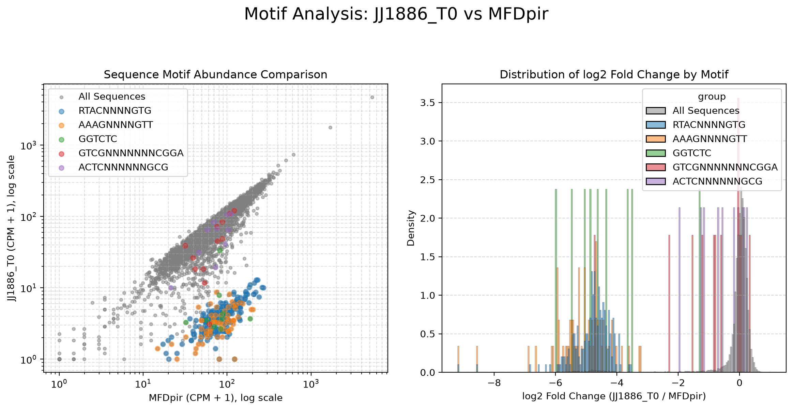

# randseq


<!-- WARNING: THIS FILE WAS AUTOGENERATED! DO NOT EDIT! -->

## Installation

Install latest from the GitHub [repository](https://github.com/dbikard/randseq):

``` sh
$ pip install git+https://github.com/dbikard/randseq.git
```

Optionally, with a compiled scan that is about 13x faster on 8 cores and gives identical results:

``` sh
$ pip install "randseq[fast] @ git+https://github.com/dbikard/randseq.git"
```

## Usage

``` python
from randseq.core import find_restricted_motifs
from randseq.utils import calculate_log2fc, get_patterns
from randseq.example_data import get_example_data_dir
import pandas as pd

#Importing some example data
data_path=get_example_data_dir()
counts_file="countsTable.csv.gz"
file_path=os.path.join(data_path,counts_file)
counts=pd.read_csv(file_path, index_col=0)
counts = counts[[col for col in counts.columns if ("_T0" in col) or ("MFDpir" in col)]]
left, right = "GTCCTAGGTATAATACTAGT", "GTTTTAGAGCTAGAAATAGC" #sequence context of the random library DNA

#Computing log2FC to reference sample
log2fc_df = calculate_log2fc(counts, reference_column='MFDpir', count_threshold=20, pseudocount=1)

#Running the pipeling
# searches every architecture in get_patterns() by default; pass flexible_motif_patterns to narrow it
flexible_motifs_df = find_restricted_motifs(log2fc_df["JJ1886_T0"], left, right)
```

    667 candidate(s) across all patterns; 464 remain after step 3.
    458 candidate(s) whose score was borrowed:
        AAAANNNNNCTTT <- AACNNNNCTTT + 1 more (without them: n=2, score=0.00)
        AAAGNAAGG <- AACNNNNCTTT (without them: n=3, score=0.00)
        AAAGNACCG <- AACNNNNCTTT + 2 more (without them: n=4, score=0.00)
        AAAGNCACA <- CACNNNNGTAT (without them: n=4, score=0.50)
        AAAGNGGTG <- AACNNNNCTTT (without them: n=3, score=0.00)
        AAAGNNAAGT <- AACNNNNCTTT (without them: n=2, score=0.00)
        AAAGNNACGT <- AACNNNNCTTT (without them: n=4, score=0.00)
        AAAGNNCAGT <- AACNNNNCTTT (without them: n=2, score=0.00)
        AAAGNNCCGT <- AACNNNNCTTT + 1 more (without them: n=1, score=0.00)
        AAAGNNGAGT <- AACNNNNCTTT (without them: n=3, score=0.00)
        AAAGNNNCATT <- CACNNNNGTAT (without them: n=5, score=0.40)
        AAAGNNNNNNNAATG <- AACNNNNCTTT (without them: n=4, score=0.25)
        AAAGNNNNNNNNTAGA <- AACNNNNCTTT + 1 more (without them: n=0, score=0.00)
        AAAGNNNNNNNTTAG <- AACNNNNCTTT + 1 more (without them: n=1, score=0.00)
        AAAGNNNNNNTTTA <- AACNNNNCTTT + 1 more (without them: n=2, score=0.00)
        AAAGNNNNNTTCC <- AACNNNNCTTT (without them: n=3, score=0.00)
        AAAGNTACG <- AACNNNNCTTT (without them: n=2, score=0.00)
        AAAGNTTTG <- AACNNNNCTTT (without them: n=4, score=0.25)
        AAATNNNNNNNAACT <- (no stronger motif) (without them: n=6, score=0.50)
        AACANNGCTT <- AACNNNNCTTT (without them: n=6, score=0.00)
        AACANTTGA <- (no stronger motif) (without them: n=8, score=0.50)
        AACCNTCTA <- (no stronger motif) (without them: n=5, score=0.60)
        AACTNNCTAT <- CACNNNNGTAT (without them: n=5, score=0.40)
        AACTNNNNNNNCACA <- CACNNNNGTAT (without them: n=4, score=0.00)
        AACTNNNNNTTGT <- AACNNNNCTTT + 1 more (without them: n=4, score=0.00)
        AAGANACGT <- AACNNNNCTTT (without them: n=6, score=0.33)
        AAGANCACA <- CACNNNNGTAT (without them: n=3, score=0.00)
        AAGANNACAC <- CACNNNNGTAT (without them: n=3, score=0.00)
        AAGANNNNNNNNCACA <- CACNNNNGTAT (without them: n=3, score=0.00)
        AAGCNGTGT <- AACNNNNCTTT + 1 more (without them: n=3, score=0.00)
        AAGCNNGCAT <- (no stronger motif) (without them: n=5, score=0.60)
        AAGCNNNNACGT <- CACNNNNGTAT (without them: n=5, score=0.40)
        AAGCNNNNNNAGAA <- CACNNNNGTAT (without them: n=6, score=0.50)
        AAGCNNNNNNNNGCAA <- AACNNNNCTTT (without them: n=4, score=0.50)
        AAGGNNNNNNNNTCAC <- CACNNNNGTAT (without them: n=4, score=0.25)
        AAGNNNNNGCAC <- CACNNNNGTAT (without them: n=6, score=0.50)
        AAGNNNNNNCACA <- CACNNNNGTAT (without them: n=4, score=0.25)
        AAGNNNNNNNNAGAA <- CACNNNNGTAT (without them: n=7, score=0.43)
        AAGTNNNNNNAGCA <- CACNNNNGTAT (without them: n=3, score=0.33)
        AAGTNNNNNNCACT <- CACNNNNGTAT (without them: n=4, score=0.25)
        AAGTNNNNNNNATGC <- AACNNNNCTTT (without them: n=4, score=0.25)
        AAGTNNNNNTAGC <- CACNNNNGTAT (without them: n=3, score=0.33)
        AAGTNNNNTTAA <- AACNNNNCTTT (without them: n=3, score=0.67)
        AAGTNNNNTTAC <- AACNNNNCTTT + 1 more (without them: n=3, score=0.00)
        AAGTNTGGC <- (no stronger motif) (without them: n=6, score=0.50)
        AAGTNTTGT <- AACNNNNCTTT + 1 more (without them: n=4, score=0.00)
        AATANNNNTGTG <- CACNNNNGTAT + 1 more (without them: n=2, score=0.00)
        AATCNGTAG <- CACNNNNGTAT (without them: n=7, score=0.43)
        AATGNNNNCACC <- CACNNNNGTAT + 1 more (without them: n=4, score=0.25)
        AATNCTAA <- (no stronger motif) (without them: n=6, score=0.50)
        ACAANGGAG <- CACNNNNGTAT (without them: n=3, score=0.33)
        ACAANNGTAC <- CACNNNNGTAC + 1 more (without them: n=6, score=0.17)
        ACAANNNNNCTGA <- CACNNNNGTAT (without them: n=5, score=0.40)
        ACAANNNNNNNNGATC <- CACNNNNGTAT (without them: n=4, score=0.50)
        ACACNNNCCTG <- (no stronger motif) (without them: n=6, score=0.50)
        ACACNNNNNAACG <- CACNNNNGTAT (without them: n=5, score=0.40)
        ACACNNNNNNACGC <- CACNNNNGTAT (without them: n=5, score=0.40)
        ACACNNNNNNCACA <- CACNNNNGTAT (without them: n=3, score=0.00)
        ACAGNGAGA <- (no stronger motif) (without them: n=5, score=0.60)
        ACAGNNNNAAGG <- (no stronger motif) (without them: n=6, score=0.50)
        ACAGNNNNNNAAGG <- (no stronger motif) (without them: n=6, score=0.50)
        ACAGNNNNNNNGGCA <- CACNNNNGTAT (without them: n=5, score=0.40)
        ACANNNGAGG <- CACNNNNGTAT (without them: n=4, score=0.50)
        ACATNNNNNTTTC <- CACNNNNGTAT (without them: n=5, score=0.40)
        ACCANNNNNCACA <- CACNNNNGTAT (without them: n=2, score=0.00)
        ACCCNNNNNNCACA <- CACNNNNGTAT (without them: n=2, score=0.00)
        ACCGNACGG <- CACNNNNGTAC + 1 more (without them: n=4, score=0.25)
        ACCGNNCACA <- CACNNNNGTAT (without them: n=4, score=0.00)
        ACCGNNNNNACAC <- CACNNNNGTAT (without them: n=3, score=0.00)
        ACCGNNNTATG <- CACNNNNGTAT (without them: n=5, score=0.40)
        ACCNNNCTTT <- AACNNNNCTTT (without them: n=10, score=0.00)
        ACCNNNNNNNNGGTC <- CACNNNNGTAT (without them: n=9, score=0.44)
        ACCTNNNCTTG <- CACNNNNGTAT (without them: n=4, score=0.75)
        ACCTNNNNNNCGAA <- CACNNNNGTAT + 1 more (without them: n=8, score=0.38)
        ACGANNNNNACAC <- CACNNNNGTAT (without them: n=3, score=0.33)
        ACGANNNNNGGTA <- (no stronger motif) (without them: n=5, score=0.60)
        ACGCNNCACA <- CACNNNNGTAT (without them: n=3, score=0.00)
        ACGGNNACTC <- CGCNNNNNNGAGT (without them: n=5, score=0.40)
        ACGGNTGCA <- (no stronger motif) (without them: n=5, score=0.60)
        ACGTNNNNNAAGG <- CACNNNNGTAT (without them: n=5, score=0.40)
        ACGTNNNNNNTGCT <- (no stronger motif) (without them: n=6, score=0.50)
        ACTCNCACT <- CACNNNNGTAT (without them: n=3, score=0.33)
        ACTCNNNAACG <- CACNNNNGTAT (without them: n=5, score=0.40)
        ACTCNNNNNCGTA <- CACNNNNGTAT (without them: n=3, score=0.33)
        ACTTNGTTG <- CACNNNNGTAT (without them: n=7, score=0.43)
        ACTTNNAGTA <- AACNNNNCTTT + 1 more (without them: n=4, score=0.25)
        ACTTNNNACAC <- CACNNNNGTAT (without them: n=3, score=0.33)
        ACTTNNNGTAC <- AACNNNNCTTT + 1 more (without them: n=4, score=0.25)
        ACTTNNNNACCA <- AACNNNNCTTT (without them: n=2, score=0.00)
        ACTTNNNNNNNAACG <- CACNNNNGTAT + 1 more (without them: n=2, score=0.00)
        ACTTNNNNNNNCACA <- CACNNNNGTAT + 1 more (without them: n=3, score=0.00)
        AGAANGATA <- (no stronger motif) (without them: n=5, score=0.60)
        AGACCTC <- GAGACC (without them: n=5, score=0.20)
        AGACNNCCCA <- GAGACC (without them: n=5, score=0.40)
        AGACNNCTGC <- GAGACC (without them: n=3, score=0.00)
        AGACNNNCTGG <- AACNNNNCTTT (without them: n=4, score=0.50)
        AGACNNNNNGGCA <- AACNNNNCTTT + 1 more (without them: n=3, score=0.33)
        AGACNNNTGCC <- GAGACC (without them: n=3, score=0.00)
        AGACNNTACT <- AACNNNNCTTT (without them: n=5, score=0.40)
        AGACNTCTG <- GAGACC (without them: n=3, score=0.33)
        AGAGNNNTCAG <- GAGACC (without them: n=2, score=0.50)
        AGANNNCTCA <- GAGACC + 1 more (without them: n=4, score=0.00)
        AGANNNNNCACA <- CACNNNNGTAT (without them: n=4, score=0.25)
        AGANNNNNNNAGTG <- AACNNNNCTTT + 1 more (without them: n=4, score=0.25)
        AGANNTCTC <- GAGACC (without them: n=3, score=0.00)
        AGATNAGCA <- CACNNNNGTAT (without them: n=4, score=0.25)
        AGCANNNGTGA <- AACNNNNCTTT (without them: n=5, score=0.40)
        AGCANNNNAAGA <- (no stronger motif) (without them: n=6, score=0.50)
        AGCANNNNTACC <- CACNNNNGTAT (without them: n=4, score=0.50)
        AGCANNNNTGAT <- AACNNNNCTTT (without them: n=8, score=0.50)
        AGCCNTTCG <- CACNNNNGTAT (without them: n=4, score=0.50)
        AGCGNNNNNGTTC <- CACNNNNGTAT (without them: n=5, score=0.40)
        AGCGNNNNNNNAAGA <- CACNNNNGTAT (without them: n=5, score=0.40)
        AGCGNNTCTG <- CACNNNNGTAT (without them: n=5, score=0.40)
        AGCTNCTGA <- (no stronger motif) (without them: n=5, score=0.60)
        AGCTNTTGC <- CACNNNNGTAT + 1 more (without them: n=3, score=0.33)
        AGGCNCACT <- CACNNNNGTAT (without them: n=2, score=0.00)
        AGGCNGAGG <- GAGACC (without them: n=3, score=0.00)
        AGGCNNNGGTC <- GAGACC (without them: n=3, score=0.00)
        AGGCNNNNNNNTCAG <- GAGACC (without them: n=2, score=0.00)
        AGGCNNNNNTCTC <- GAGACC (without them: n=2, score=0.00)
        AGGNCTC <- GAGACC (without them: n=5, score=0.00)
        AGGNNNGTTC <- AACNNNNCTTT (without them: n=5, score=0.40)
        AGGNNNNNGTCT <- GAGACC (without them: n=3, score=0.00)
        AGGNNNNNNNCTCA <- GAGACC + 1 more (without them: n=1, score=0.00)
        AGGTNNATAT <- CACNNNNGTAT (without them: n=5, score=0.40)
        AGGTNNNGCAA <- CACNNNNGTAT (without them: n=4, score=0.50)
        AGGTNNNNNNCAAC <- (no stronger motif) (without them: n=5, score=0.60)
        AGGTNNNNNTCGC <- (no stronger motif) (without them: n=6, score=0.50)
        AGGTNTCAG <- GAGACC (without them: n=2, score=0.00)
        AGTANNCTTG <- CACNNNNGTAC (without them: n=5, score=0.40)
        AGTGNGCAG <- CACNNNNGTAT + 1 more (without them: n=10, score=0.10)
        AGTGNGCGG <- CACNNNNGTAT + 1 more (without them: n=4, score=0.00)
        AGTGNGCTG <- CACNNNNGTAT (without them: n=5, score=0.00)
        ATAANNNNGAGC <- (no stronger motif) (without them: n=6, score=0.50)
        ATAANNNNNNTGTG <- CACNNNNGTAT + 1 more (without them: n=3, score=0.00)
        ATANCACA <- CACNNNNGTAT (without them: n=8, score=0.12)
        ATANNACAC <- CACNNNNGTAT (without them: n=11, score=0.09)
        ATCANNNNNNNNGACA <- CACNNNNGTAT + 1 more (without them: n=3, score=0.33)
        ATCCNNNNNNNNCGCA <- (no stronger motif) (without them: n=5, score=0.60)
        ATCTNCGTC <- CACNNNNGTAT (without them: n=3, score=0.33)
        ATCTNNNNCACA <- CACNNNNGTAT (without them: n=2, score=0.00)
        ATCTNNNNNNNGTTG <- CACNNNNGTAT (without them: n=4, score=0.50)
        ATCTTAG <- (no stronger motif) (without them: n=6, score=0.50)
        ATGANCAAG <- AACNNNNCTTT (without them: n=4, score=0.50)
        ATGANNTGAA <- (no stronger motif) (without them: n=6, score=0.50)
        ATGCNNNNNNCACA <- CACNNNNGTAT (without them: n=3, score=0.00)
        ATGCNNNNNNNACAC <- CACNNNNGTAT (without them: n=3, score=0.00)
        ATGGNCGTA <- CACNNNNGTAT (without them: n=5, score=0.40)
        ATGGNNNNNNACAC <- CACNNNNGTAT (without them: n=4, score=0.25)
        ATGGNNNNNTCCA <- CACNNNNGTAT (without them: n=5, score=0.40)
        ATGGTCC <- CACNNNNGTAT + 1 more (without them: n=4, score=0.25)
        ATGTNNNACAC <- CACNNNNGTAT + 1 more (without them: n=4, score=0.25)
        ATGTNNNACCG <- CACNNNNGTAT (without them: n=3, score=0.33)
        ATGTNNNNNNNAAAG <- AACNNNNCTTT (without them: n=3, score=0.00)
        ATTANCACA <- CACNNNNGTAT (without them: n=3, score=0.00)
        ATTANNNCCAC <- CACNNNNGTAT (without them: n=4, score=0.25)
        ATTANNNNCACA <- CACNNNNGTAT (without them: n=2, score=0.00)
        ATTCNACCA <- (no stronger motif) (without them: n=6, score=0.50)
        ATTCNNNNNNACAC <- CACNNNNGTAT (without them: n=3, score=0.00)
        ATTGNNNNNNNTCAC <- CACNNNNGTAT (without them: n=5, score=0.60)
        ATTNNNNNNNNCACA <- CACNNNNGTAT (without them: n=7, score=0.00)
        ATTTNNNNNNACAC <- CACNNNNGTAT (without them: n=4, score=0.25)
        ATTTNNNNNNNNACAC <- CACNNNNGTAT (without them: n=4, score=0.00)
        CAAANNNACCG <- AACNNNNCTTT + 2 more (without them: n=5, score=0.20)
        CAAANNNATGG <- (no stronger motif) (without them: n=6, score=0.50)
        CAAANNNNNNGTTA <- AACNNNNCTTT + 1 more (without them: n=4, score=0.25)
        CAAANNNNNNNTCAC <- CACNNNNGTAT + 1 more (without them: n=5, score=0.40)
        CAAANNNNNNNTTAA <- AACNNNNCTTT (without them: n=5, score=0.40)
        CAACNNAGTC <- (no stronger motif) (without them: n=5, score=0.60)
        CAACNNNGATG <- (no stronger motif) (without them: n=5, score=0.60)
        CAACNNNNNCGCG <- CACNNNNGTAT (without them: n=4, score=0.25)
        CAAGNNNNGGTA <- CACNNNNGTAT (without them: n=3, score=0.33)
        CAANNNNNCTTT <- AACNNNNCTTT (without them: n=9, score=0.33)
        CAATNNCACA <- CACNNNNGTAT (without them: n=3, score=0.33)
        CAATNNNNNNACAC <- CACNNNNGTAT (without them: n=3, score=0.00)
        CACACTA <- CACNNNNGTAT + 1 more (without them: n=8, score=0.00)
        CACANNAGTA <- CACNNNNGTAT + 2 more (without them: n=2, score=0.00)
        CACANNNNAACG <- (no stronger motif) (without them: n=5, score=0.60)
        CACANNNNNATTA <- CACNNNNGTAT + 1 more (without them: n=2, score=0.00)
        CACCNNACAC <- CACNNNNGTAT (without them: n=3, score=0.33)
        CACCNNNCACA <- CACNNNNGTAT (without them: n=4, score=0.00)
        CACCNNNNACAC <- CACNNNNGTAT (without them: n=8, score=0.12)
        CACGNNNNNACAC <- CACNNNNGTAT + 1 more (without them: n=3, score=0.33)
        CACGNNNNNCGGA <- CACNNNNGTAT + 1 more (without them: n=4, score=0.25)
        CACGNNNNNNNGAAC <- (no stronger motif) (without them: n=8, score=0.50)
        CACGNNNNTACC <- CACNNNNGTAT + 1 more (without them: n=3, score=0.67)
        CACNCTAG <- CACNNNNGTAT + 1 more (without them: n=1, score=0.00)
        CACNNNCGTA <- CACNNNNGTAC + 1 more (without them: n=4, score=0.00)
        CACNNNNNNNNGCTT <- CACNNNNGTAT (without them: n=4, score=0.25)
        CACNNNNNNNNTATA <- CACNNNNGTAT + 1 more (without them: n=4, score=0.00)
        CACNNNTGTA <- CACNNNNGTAC (without them: n=4, score=0.25)
        CACNNTAGT <- CACNNNNGTAT + 1 more (without them: n=2, score=0.00)
        CAGANNNNNTGGC <- AACNNNNCTTT (without them: n=5, score=0.40)
        CAGANNNNTCAG <- GAGACC (without them: n=6, score=0.33)
        CAGANTAGC <- CACNNNNGTAT (without them: n=3, score=0.33)
        CAGCNNNNNNACCC <- CACNNNNGTAT (without them: n=4, score=0.50)
        CAGCNNNNNTACC <- CACNNNNGTAT (without them: n=9, score=0.44)
        CAGTNCTAC <- (no stronger motif) (without them: n=7, score=0.57)
        CAGTNNATGC <- (no stronger motif) (without them: n=5, score=0.60)
        CAGTNNNAGGA <- (no stronger motif) (without them: n=6, score=0.50)
        CATANAGAC <- CACNNNNGTAT + 1 more (without them: n=5, score=0.40)
        CATCNAGTC <- CACNNNNGTAT (without them: n=4, score=0.50)
        CATGNNCTGA <- AACNNNNCTTT (without them: n=6, score=0.50)
        CATGNNNNNAACC <- (no stronger motif) (without them: n=6, score=0.50)
        CATGNNNNNNNCACA <- CACNNNNGTAT (without them: n=3, score=0.33)
        CATGNNNNNNNNACAC <- CACNNNNGTAT (without them: n=3, score=0.33)
        CATNNNACAC <- CACNNNNGTAT + 1 more (without them: n=7, score=0.29)
        CCAANGAAG <- CACNNNNGTAT + 1 more (without them: n=4, score=0.25)
        CCAANNNNNNCGAC <- AACNNNNCTTT (without them: n=5, score=0.40)
        CCACNACAC <- CACNNNNGTAT (without them: n=3, score=0.00)
        CCACNNNNACAC <- CACNNNNGTAT (without them: n=3, score=0.33)
        CCACNNNNNTACC <- CACNNNNGTAC + 2 more (without them: n=3, score=0.33)
        CCAGNNNNNACAC <- CACNNNNGTAT + 1 more (without them: n=3, score=0.00)
        CCCGNACAC <- CACNNNNGTAT (without them: n=3, score=0.00)
        CCCGNNNNNNNACAC <- CACNNNNGTAT (without them: n=3, score=0.00)
        CCGANNCCAC <- CACNNNNGTAT (without them: n=6, score=0.33)
        CCGANNNNACAC <- CACNNNNGTAT (without them: n=3, score=0.00)
        CCGANNNNCACA <- CACNNNNGTAT (without them: n=2, score=0.50)
        CCGCNNNNNCACA <- CACNNNNGTAT (without them: n=2, score=0.00)
        CCGGNNNNNNCCAC <- CACNNNNGTAT + 1 more (without them: n=6, score=0.33)
        CCGGNNNNNNNACAC <- CACNNNNGTAT (without them: n=4, score=0.25)
        CCGGNNNNNNNGGTC <- GAGACC (without them: n=4, score=0.25)
        CCGTNCACA <- CACNNNNGTAT (without them: n=3, score=0.00)
        CCGTNNACAC <- CACNNNNGTAT (without them: n=3, score=0.00)
        CCTGNGTAC <- CACNNNNGTAC (without them: n=6, score=0.33)
        CCTGNNAGAA <- AACNNNNCTTT (without them: n=8, score=0.50)
        CCTGNNNNACAC <- CACNNNNGTAT (without them: n=4, score=0.25)
        CCTNAGAC <- GAGACC (without them: n=3, score=0.33)
        CCTNNNCACA <- CACNNNNGTAT (without them: n=5, score=0.00)
        CCTNNNNNCTCT <- GAGACC (without them: n=6, score=0.33)
        CCTNNNNNNNNATCT <- (no stronger motif) (without them: n=5, score=0.60)
        CCTNNNNNNNNCACA <- CACNNNNGTAT (without them: n=4, score=0.25)
        CCTTNNNNNACCA <- AACNNNNCTTT (without them: n=5, score=0.40)
        CCTTNNNNNNNGTTA <- CACNNNNGTAT (without them: n=4, score=0.50)
        CGAANNNNNGACC <- (no stronger motif) (without them: n=6, score=0.50)
        CGAANNNTAGA <- (no stronger motif) (without them: n=5, score=0.60)
        CGACNNGGGC <- CACNNNNGTAT (without them: n=3, score=0.33)
        CGACNNNGACC <- (no stronger motif) (without them: n=6, score=0.50)
        CGACNTCAG <- CACNNNNGTAT (without them: n=5, score=0.40)
        CGAGNNNGAAG <- CACNNNNGTAT (without them: n=4, score=0.50)
        CGATNNNNNNGGTC <- (no stronger motif) (without them: n=6, score=0.50)
        CGCANGTGA <- CACNNNNGTAC (without them: n=5, score=0.40)
        CGCANNNCGGA <- CACNNNNGTAT (without them: n=6, score=0.50)
        CGCANNNNGGAG <- CACNNNNGTAT (without them: n=4, score=0.50)
        CGCCNNCACA <- CACNNNNGTAT (without them: n=2, score=0.00)
        CGCGNNNNCCGA <- GTCGNNNNNNNCGGA (without them: n=4, score=0.25)
        CGCGNNNNNACAC <- CACNNNNGTAT (without them: n=4, score=0.25)
        CGCTNCACA <- CACNNNNGTAT (without them: n=3, score=0.00)
        CGGANGCTC <- (no stronger motif) (without them: n=6, score=0.50)
        CGGANNNNNNGGTC <- GAGACC (without them: n=3, score=0.33)
        CGGCNNNNNNNNTCAC <- CACNNNNGTAT (without them: n=5, score=0.40)
        CGGCNNNNNTAAG <- CACNNNNGTAT (without them: n=4, score=0.25)
        CGGGNNNNNNNGTTC <- (no stronger motif) (without them: n=5, score=0.60)
        CGGTNGGAC <- CACNNNNGTAT (without them: n=5, score=0.40)
        CGGTNNGGGC <- AACNNNNCTTT (without them: n=5, score=0.40)
        CGGTNNNNNACCG <- (no stronger motif) (without them: n=5, score=0.60)
        CGGTNNNNNNNNCACA <- CACNNNNGTAT + 1 more (without them: n=3, score=0.33)
        CGTANCACA <- CACNNNNGTAT (without them: n=2, score=0.00)
        CGTANNACAC <- CACNNNNGTAT (without them: n=5, score=0.20)
        CGTCNNNNNTTCC <- (no stronger motif) (without them: n=5, score=0.60)
        CGTGNNCACA <- CACNNNNGTAT + 1 more (without them: n=3, score=0.00)
        CGTNNNNNNNNGTAG <- CACNNNNGTAT (without them: n=2, score=0.00)
        CGTTNNNACAC <- CACNNNNGTAT (without them: n=4, score=0.25)
        CGTTNNNNNNNNCACA <- CACNNNNGTAT (without them: n=3, score=0.33)
        CTACNNNNNNAAAC <- CACNNNNGTAT (without them: n=3, score=0.33)
        CTACNNNNNNNGCAC <- CACNNNNGTAT (without them: n=3, score=0.67)
        CTACNNNNTCCA <- CACNNNNGTAT (without them: n=4, score=0.50)
        CTANGATT <- CACNNNNGTAT (without them: n=4, score=0.75)
        CTANTGTG <- CACNNNNGTAT + 1 more (without them: n=2, score=0.00)
        CTATNGTTC <- (no stronger motif) (without them: n=7, score=0.57)
        CTCCNNNCTGC <- CGCNNNNNNGAGT + 1 more (without them: n=3, score=0.00)
        CTCCNTATC <- (no stronger motif) (without them: n=5, score=0.60)
        CTCCNTCAC <- CACNNNNGTAT (without them: n=4, score=0.50)
        CTCNNNNNTCTC <- CACNNNNGTAT (without them: n=5, score=0.40)
        CTCNNNNTCCG <- GAGACC (without them: n=7, score=0.43)
        CTCTNACAC <- CACNNNNGTAT + 1 more (without them: n=3, score=0.33)
        CTGANNGTCA <- AACNNNNCTTT (without them: n=6, score=0.50)
        CTGANNNNNNACAC <- CACNNNNGTAT + 1 more (without them: n=3, score=0.00)
        CTGANNNNNNNNACCA <- CACNNNNGTAT + 1 more (without them: n=3, score=0.00)
        CTGCNNNNNNACAC <- CACNNNNGTAT (without them: n=5, score=0.40)
        CTGGNNNNNNNCACA <- CACNNNNGTAT (without them: n=2, score=0.00)
        CTGGNNNNNNNNCACA <- CACNNNNGTAT (without them: n=1, score=0.00)
        CTGNGTAG <- CACNNNNGTAT (without them: n=4, score=0.50)
        CTGNNCTCC <- CACNNNNGTAT (without them: n=4, score=0.25)
        CTGNNNNNNACTC <- CACNNNNGTAT (without them: n=5, score=0.40)
        CTTCNNACAC <- CACNNNNGTAT (without them: n=4, score=0.25)
        CTTCNNNNGTGA <- CACNNNNGTAT (without them: n=4, score=0.25)
        CTTCNNNNNCACA <- CACNNNNGTAT (without them: n=3, score=0.33)
        CTTCNNNNNNGCAA <- AACNNNNCTTT (without them: n=5, score=0.40)
        CTTCNNNNNNNNCCAC <- CACNNNNGTAT (without them: n=4, score=0.25)
        CTTNACAT <- CACNNNNGTAT (without them: n=6, score=0.33)
        CTTNCACA <- CACNNNNGTAT + 1 more (without them: n=11, score=0.09)
        CTTTNCACA <- CACNNNNGTAT (without them: n=2, score=0.00)
        CTTTNNCCCC <- AACNNNNCTTT (without them: n=2, score=0.00)
        CTTTNNNNNGAAC <- AACNNNNCTTT + 1 more (without them: n=3, score=0.33)
        CTTTNNNNNNCACA <- CACNNNNGTAT + 1 more (without them: n=3, score=0.00)
        GAAANNNNACGA <- CACNNNNGTAT (without them: n=4, score=0.50)
        GAACNAAGC <- AACNNNNCTTT (without them: n=3, score=0.33)
        GAACNCTAC <- (no stronger motif) (without them: n=6, score=0.50)
        GAACNNCTTC <- (no stronger motif) (without them: n=5, score=0.60)
        GAAGNNNACAC <- CACNNNNGTAT (without them: n=2, score=0.50)
        GAAGNNNNNNNAGAA <- (no stronger motif) (without them: n=8, score=0.50)
        GAAGNNNTTGC <- CACNNNNGTAT (without them: n=5, score=0.40)
        GAANNCTCC <- (no stronger motif) (without them: n=6, score=0.50)
        GAANNNCACA <- CACNNNNGTAT (without them: n=9, score=0.22)
        GAANNNNCTAT <- (no stronger motif) (without them: n=5, score=0.60)
        GAATNGGTA <- (no stronger motif) (without them: n=6, score=0.50)
        GAATNNATGA <- AACNNNNCTTT (without them: n=5, score=0.40)
        GAATNNNACAC <- CACNNNNGTAT (without them: n=5, score=0.40)
        GAATNNNACGC <- CACNNNNGTAT (without them: n=4, score=0.25)
        GAATNNNTGAC <- CACNNNNGTAT (without them: n=5, score=0.40)
        GACCNCTGC <- GAGACC + 1 more (without them: n=2, score=0.00)
        GACCNGGGC <- CACNNNNGTAT (without them: n=3, score=0.33)
        GACCNNNNNAATC <- CACNNNNGTAT (without them: n=5, score=0.40)
        GACCNNNNNCTCC <- GAGACC (without them: n=4, score=0.25)
        GACCNTAAA <- CACNNNNGTAT + 2 more (without them: n=3, score=0.33)
        GACGNNNACAC <- CACNNNNGTAT + 1 more (without them: n=3, score=0.00)
        GACGNNNNNNNATCA <- CACNNNNGTAT (without them: n=4, score=0.50)
        GACNNNNCACA <- CACNNNNGTAT (without them: n=4, score=0.25)
        GACNNNNNCCTC <- GAGACC (without them: n=4, score=0.25)
        GACNNNNNNNNGATC <- (no stronger motif) (without them: n=6, score=0.50)
        GACNNNNNNNTTGG <- CACNNNNGTAT (without them: n=5, score=0.40)
        GACTNNCACA <- CACNNNNGTAT (without them: n=3, score=0.00)
        GACTNNGTTA <- CACNNNNGTAT (without them: n=4, score=0.50)
        GAGANNNCTGC <- GAGACC (without them: n=2, score=0.00)
        GAGNNNNNNNCCTC <- GAGACC + 1 more (without them: n=1, score=0.00)
        GAGNNNNNNNGTTC <- CACNNNNGTAT + 1 more (without them: n=3, score=0.33)
        GAGNNNNNNNNCTCA <- GAGACC + 1 more (without them: n=1, score=0.00)
        GAGNTCTC <- GAGACC (without them: n=3, score=0.00)
        GATCNGAAC <- CACNNNNGTAT (without them: n=7, score=0.43)
        GATCNNNNCACC <- CACNNNNGTAT (without them: n=4, score=0.50)
        GATTNNNNNNCACA <- CACNNNNGTAT (without them: n=2, score=0.00)
        GATTNNNNNNNACAC <- CACNNNNGTAT (without them: n=3, score=0.00)
        GCAANGTTA <- AACNNNNCTTT (without them: n=4, score=0.25)
        GCAANNNNNNNNACAC <- CACNNNNGTAT (without them: n=2, score=0.00)
        GCACNGCGC <- (no stronger motif) (without them: n=6, score=0.50)
        GCACNNNACAC <- CACNNNNGTAT (without them: n=3, score=0.00)
        GCACNNNCACA <- CACNNNNGTAT (without them: n=3, score=0.00)
        GCACNNNNACAC <- CACNNNNGTAT (without them: n=4, score=0.25)
        GCACNNNNNNACAC <- CACNNNNGTAT + 1 more (without them: n=3, score=0.00)
        GCACNNNNNNNCACA <- CACNNNNGTAT (without them: n=2, score=0.50)
        GCAGNNCGGA <- CGCNNNNNNGAGT + 1 more (without them: n=3, score=0.00)
        GCANGTAT <- CACNNNNGTAT (without them: n=8, score=0.38)
        GCANNNNNNCACA <- CACNNNNGTAT (without them: n=4, score=0.00)
        GCANNNNNNNNTATC <- (no stronger motif) (without them: n=5, score=0.60)
        GCATNNNNNNNACAC <- CACNNNNGTAT (without them: n=3, score=0.33)
        GCCCNNACAC <- CACNNNNGTAT + 1 more (without them: n=3, score=0.00)
        GCCGNNNNNNACGC <- CACNNNNGTAT + 1 more (without them: n=3, score=0.00)
        GCGANNNNCACA <- CACNNNNGTAT + 2 more (without them: n=3, score=0.00)
        GCGANNNNGCCC <- CACNNNNGTAT + 1 more (without them: n=3, score=0.33)
        GCGANNNNNNNNGAAA <- (no stronger motif) (without them: n=5, score=0.60)
        GCGCNNNNCGGA <- AACNNNNCTTT (without them: n=4, score=0.50)
        GCGCNNNNNCACA <- CACNNNNGTAT (without them: n=4, score=0.25)
        GCGTNNNNNNNAGAA <- CACNNNNGTAT (without them: n=5, score=0.40)
        GCTANNNNNNNCTCC <- CACNNNNGTAT (without them: n=2, score=0.00)
        GCTGNNNNACAA <- CACNNNNGTAT (without them: n=4, score=0.50)
        GCTGNNNTCGA <- CACNNNNGTAT (without them: n=5, score=0.40)
        GCTTNNNNNNCACA <- CACNNNNGTAT (without them: n=2, score=0.00)
        GCTTNNNNNNNACAC <- CACNNNNGTAT (without them: n=3, score=0.00)
        GGAANNNATGA <- (no stronger motif) (without them: n=5, score=0.60)
        GGAANNNNNNGACA <- (no stronger motif) (without them: n=6, score=0.50)
        GGACNNNNNNNNGATA <- AACNNNNCTTT (without them: n=4, score=0.50)
        GGAGNNNNNNNNAGCA <- CACNNNNGTAT (without them: n=2, score=0.00)
        GGANCCTT <- AACNNNNCTTT + 1 more (without them: n=4, score=0.25)
        GGANNNNGAGG <- GAGACC (without them: n=4, score=0.25)
        GGANNNNNCTTG <- CACNNNNGTAT (without them: n=6, score=0.33)
        GGANNNNNNTCAT <- CACNNNNGTAT (without them: n=4, score=0.50)
        GGCANNNNNNNCACA <- CACNNNNGTAT (without them: n=3, score=0.00)
        GGCANNNNNNNNACAC <- CACNNNNGTAT (without them: n=2, score=0.00)
        GGCGNNNNNCTAA <- (no stronger motif) (without them: n=6, score=0.50)
        GGCGNNNNNNNTGTA <- CACNNNNGTAT (without them: n=5, score=0.40)
        GGCNNNNNCACA <- CACNNNNGTAT (without them: n=6, score=0.00)
        GGGCNNNNNACAC <- CACNNNNGTAT (without them: n=3, score=0.00)
        GGGNNCTAT <- (no stronger motif) (without them: n=5, score=0.60)
        GGGNNNGAGT <- (no stronger motif) (without them: n=6, score=0.50)
        GGGNNNNAAGC <- AACNNNNCTTT (without them: n=3, score=0.33)
        GGGNNNNNGTTC <- CACNNNNGTAC (without them: n=4, score=0.50)
        GGGNNNNNNNNGTAA <- CACNNNNGTAT (without them: n=3, score=0.33)
        GGGNTCTA <- (no stronger motif) (without them: n=6, score=0.50)
        GGTANNNNNNNACAC <- CACNNNNGTAT (without them: n=2, score=0.00)
        GGTCNCTAC <- (no stronger motif) (without them: n=7, score=0.57)
        GGTNGGGG <- AACNNNNCTTT (without them: n=7, score=0.43)
        GGTNNNNNNNGTAG <- (no stronger motif) (without them: n=10, score=0.50)
        GTACNNNNNNNNCACA <- CACNNNNGTAT + 1 more (without them: n=1, score=0.00)
        GTAGNNNNNNNNTCAA <- AACNNNNCTTT (without them: n=3, score=0.33)
        GTANNNNNGTGT <- CACNNNNGTAC + 1 more (without them: n=8, score=0.25)
        GTCNNNNNNCTTG <- (no stronger motif) (without them: n=6, score=0.50)
        GTCTNNNNNNNCACA <- CACNNNNGTAT + 1 more (without them: n=2, score=0.00)
        GTCTNNNNNNNCGAA <- AACNNNNCTTT (without them: n=5, score=0.40)
        GTCTNNNNNNNNACAC <- CACNNNNGTAT (without them: n=4, score=0.25)
        GTGANNTACA <- (no stronger motif) (without them: n=8, score=0.50)
        GTGCNNACAC <- (no stronger motif) (without them: n=6, score=0.50)
        GTGCNNNNCAAA <- CACNNNNGTAT + 1 more (without them: n=6, score=0.33)
        GTGCNNNNNNNNCAAA <- AACNNNNCTTT (without them: n=4, score=0.50)
        GTGCNNNNNNNTTAA <- CACNNNNGTAT (without them: n=5, score=0.40)
        GTGGNNNNNNCAAA <- CACNNNNGTAT + 1 more (without them: n=4, score=0.25)
        GTGGNNNNNNNACAC <- CACNNNNGTAT (without them: n=3, score=0.33)
        GTGGNNNNNNNCCAA <- CACNNNNGTAT + 1 more (without them: n=4, score=0.25)
        GTGNNNNNNTCTA <- CACNNNNGTAT (without them: n=3, score=0.00)
        GTGTNACCA <- CACNNNNGTAT (without them: n=6, score=0.33)
        GTGTNCGGA <- CACNNNNGTAT + 2 more (without them: n=5, score=0.40)
        GTGTNCTAA <- CACNNNNGTAT (without them: n=3, score=0.00)
        GTGTNNCAAC <- CACNNNNGTAT (without them: n=3, score=0.00)
        GTGTNNGTAA <- CACNNNNGTAT (without them: n=3, score=0.00)
        GTGTNNNGAGA <- CACNNNNGTAT (without them: n=3, score=0.33)
        GTGTNNNNATAA <- CACNNNNGTAT (without them: n=1, score=0.00)
        GTGTNNNNCGGA <- CACNNNNGTAT (without them: n=3, score=0.67)
        GTGTNNNNNCAAA <- CACNNNNGTAT (without them: n=4, score=0.25)
        GTGTNNNNNCAAC <- CACNNNNGTAT (without them: n=3, score=0.33)
        GTGTNNNNNCGAA <- CACNNNNGTAT (without them: n=5, score=0.20)
        GTGTNNNNNGTGA <- CACNNNNGTAT (without them: n=4, score=0.25)
        GTGTNNNNNNCACA <- CACNNNNGTAT (without them: n=3, score=0.33)
        GTGTNNNNNNNCAAA <- CACNNNNGTAT (without them: n=2, score=0.00)
        GTGTNNNNNNNCAGA <- CACNNNNGTAT (without them: n=3, score=0.67)
        GTGTNNNNNNNNAATA <- CACNNNNGTAT (without them: n=2, score=0.00)
        GTGTNNNNNNNNCGGA <- CACNNNNGTAT (without them: n=3, score=0.33)
        GTGTNNNNNNNNGGTA <- CACNNNNGTAT (without them: n=2, score=0.00)
        GTGTNNNNNNNNTAAC <- CACNNNNGTAT (without them: n=3, score=0.00)
        GTGTNNNNNTCAA <- CACNNNNGTAT (without them: n=4, score=0.00)
        GTTANNNNNNNCACA <- CACNNNNGTAT (without them: n=2, score=0.00)
        GTTCNGGAA <- CACNNNNGTAT (without them: n=5, score=0.40)
        GTTCNNNGCAA <- (no stronger motif) (without them: n=6, score=0.50)
        GTTGNNNNNNCCAA <- CACNNNNGTAT + 1 more (without them: n=4, score=0.25)
        TAACNNNNNNNNCACA <- CACNNNNGTAT (without them: n=1, score=0.00)
        TACCNNNNNCACA <- CACNNNNGTAT (without them: n=3, score=0.33)
        TACNNNAGTG <- CACNNNNGTAC (without them: n=3, score=0.00)
        TACNNNGGTG <- CACNNNNGTAC + 1 more (without them: n=8, score=0.12)
        TAGCNNNNNNNTCAA <- AACNNNNCTTT (without them: n=3, score=0.33)
        TATCNNCACA <- CACNNNNGTAT (without them: n=4, score=0.00)
        TATCNNNNNNNNCACA <- CACNNNNGTAT (without them: n=4, score=0.25)
        TATNNNNNNNNTGTG <- CACNNNNGTAT + 1 more (without them: n=6, score=0.00)
        TCANNNNNNNNGGAG <- (no stronger motif) (without them: n=5, score=0.60)
        TCATNNNNNNNACAA <- AACNNNNCTTT (without them: n=4, score=0.25)
        TCCGNNNNNNNCGCA <- (no stronger motif) (without them: n=5, score=0.60)
        TCCTNATCA <- (no stronger motif) (without them: n=6, score=0.50)
        TCGANGTCA <- (no stronger motif) (without them: n=6, score=0.50)
        TCTCNNNNNNCACA <- CACNNNNGTAT + 1 more (without them: n=2, score=0.00)
        TGCGNNACAA <- CACNNNNGTAT + 1 more (without them: n=4, score=0.25)
        TGCGNNNCAAA <- AACNNNNCTTT (without them: n=5, score=0.40)
        TGCNCTCC <- CACNNNNGTAT (without them: n=7, score=0.43)
        TGCTNNNNAACA <- (no stronger motif) (without them: n=6, score=0.50)
        TGGCNNNCACA <- CACNNNNGTAT (without them: n=2, score=0.00)
        TGGCNNNNNNNGACA <- CACNNNNGTAT + 1 more (without them: n=3, score=0.33)
        TGTGNCCAA <- CACNNNNGTAT + 1 more (without them: n=5, score=0.20)
        TGTGNNNATAA <- CACNNNNGTAT (without them: n=1, score=0.00)
        TGTGNNNNNCAAA <- CACNNNNGTAT + 1 more (without them: n=4, score=0.00)
        TGTGNNNNNNGTAA <- CACNNNNGTAT (without them: n=3, score=0.00)
        TGTGNNTCAA <- CACNNNNGTAT (without them: n=3, score=0.33)
        TGTNNCGAG <- CACNNNNGTAT (without them: n=3, score=0.00)
        TGTNNNNCCAA <- CACNNNNGTAT (without them: n=4, score=0.25)
        TGTNNNNNNNGGAG <- CACNNNNGTAT (without them: n=7, score=0.43)
        TGTNNNNNNNNGAGT <- CACNNNNGTAT (without them: n=7, score=0.43)
        TGTTNNNCGAA <- AACNNNNCTTT (without them: n=6, score=0.67)
        TTAANNNNNNNNTAAA <- AACNNNNCTTT (without them: n=2, score=0.00)
        TTACNNNNCCAA <- AACNNNNCTTT (without them: n=3, score=0.67)
        TTCNNNNNNNCACA <- CACNNNNGTAT (without them: n=6, score=0.33)
        TTTNNTAGG <- (no stronger motif) (without them: n=6, score=0.50)
    6 motif(s) reported.
      GGTCTC (pattern (6, 0, 0)), FracDep: 1.00, AvgFC: -4.36, N: 9
      AAAGNNNNGTT (pattern (4, 4, 3)), FracDep: 1.00, AvgFC: -5.21, N: 63
      ATACNNNNGTG (pattern (4, 4, 3)), FracDep: 1.00, AvgFC: -4.81, N: 192
      CACNNNNGTAC (pattern (3, 4, 4)), FracDep: 1.00, AvgFC: -5.29, N: 20
      ACTCNNNNNNGCG (pattern (4, 6, 3)), FracDep: 0.50, AvgFC: -0.58, N: 10
      GTCGNNNNNNNCGGA (pattern (4, 7, 4)), FracDep: 0.58, AvgFC: -1.03, N: 12
    1 degenerate site(s) reported as one motif:
      RTACNNNNGTG <- ATACNNNNGTG + CACNNNNGTAC

    Scanning patterns:   0%|          | 0/43 [00:00<?, ?it/s]
    Scanning patterns:  14%|#3        | 6/43 [00:00<00:00, 59.65it/s]
    Scanning patterns:  42%|####1     | 18/43 [00:00<00:00, 94.98it/s]
    Scanning patterns:  65%|######5   | 28/43 [00:00<00:00, 83.22it/s]
    Scanning patterns:  86%|########6 | 37/43 [00:00<00:00, 67.30it/s]
    Scanning patterns: 100%|##########| 43/43 [00:00<00:00, 62.82it/s]

``` python
flexible_motifs_df
```

<div>
<style scoped>
    .dataframe tbody tr th:only-of-type {
        vertical-align: middle;
    }
&#10;    .dataframe tbody tr th {
        vertical-align: top;
    }
&#10;    .dataframe thead th {
        text-align: right;
    }
</style>

|  | motif | fraction_depleted | fraction_depleted_lower | background | excess_depleted | num_sequences | avg_log2fc | p_value | pattern | q_value | called | bimodality | bimodal | merged_from |
|----|----|----|----|----|----|----|----|----|----|----|----|----|----|----|
| 4 | RTACNNNNGTG | 1.000000 | 0.985969 | 0.068428 | 1.000000 | 212 | -4.850774 | 1.172193e-247 | (4, 4, 3) | 3.828852e-242 | True | 0.475057 | False | ATACNNNNGTG+CACNNNNGTAC |
| 0 | AAAGNNNNGTT | 1.000000 | 0.953562 | 0.067413 | 1.000000 | 63 | -5.209253 | 1.625076e-74 | (4, 4, 3) | 1.040810e-70 | True | 0.402660 | False |  |
| 1 | GGTCTC | 1.000000 | 0.716871 | 0.066249 | 1.000000 | 9 | -4.363412 | 2.458181e-11 | (6, 0, 0) | 1.867698e-08 | True | 0.391853 | False |  |
| 2 | GTCGNNNNNNNCGGA | 0.583333 | 0.315238 | 0.065517 | 0.554121 | 12 | -1.030670 | 3.056747e-06 | (4, 7, 4) | 1.222096e-03 | False | 0.569429 | True |  |
| 3 | ACTCNNNNNNGCG | 0.500000 | 0.222441 | 0.062799 | 0.466496 | 10 | -0.581171 | 1.882961e-04 | (4, 6, 3) | 4.292035e-02 | False | 0.404736 | False |  |

</div>

``` python
from randseq.plotting import plot_motif_analysis
fig, axes = plot_motif_analysis(counts, "JJ1886_T0", "MFDpir", flexible_motifs_df, left, right)
```



## Documentation

Documentation can be found hosted on this GitHub [repository](https://github.com/dbikard/randseq)’s [pages](https://dbikard.github.io/randseq/). Additionally you can find package manager specific guidelines on [conda](https://anaconda.org/dbikard/randseq) and [pypi](https://pypi.org/project/randseq/) respectively.

## Developer Guide

If you are new to using `nbdev` here are some useful pointers to get you started.

### Install randseq in Development mode

``` sh
# make sure randseq package is installed in development mode
$ pip install -e .

# make changes under nbs/ directory
# ...

# compile to have changes apply to randseq
$ nbdev-prepare
```
