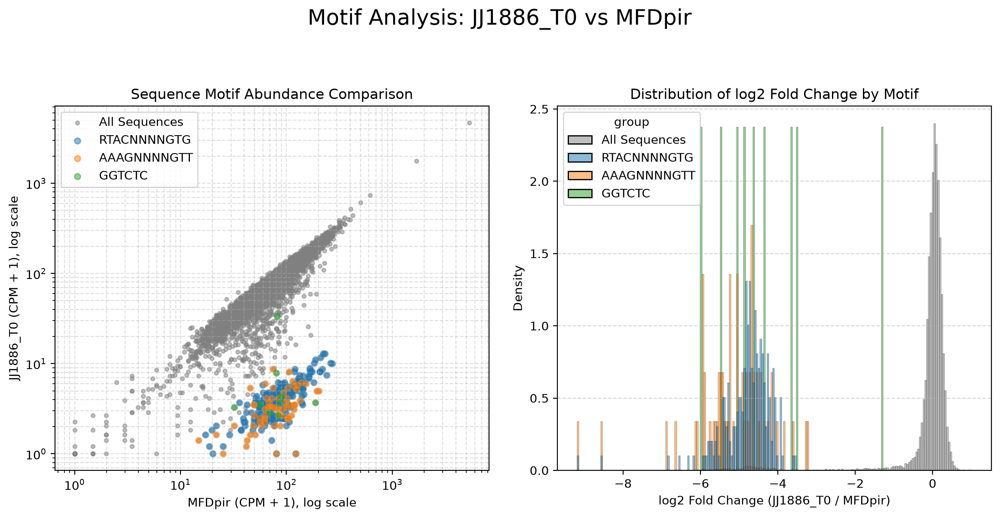

# randseq


<!-- WARNING: THIS FILE WAS AUTOGENERATED! DO NOT EDIT! -->

## Installation

Install latest from the GitHub [repository](https://github.com/dbikard/randseq):

``` sh
$ pip install git+https://github.com/dbikard/randseq.git
```

Optionally, with a compiled scan that is about 13x faster on 8 cores and gives identical results:

``` sh
$ pip install "randseq[fast] @ git+https://github.com/dbikard/randseq.git"
```

## Usage

RandSeq conjugates a library of plasmids with random inserts from a donor into a recipient strain
and counts each plasmid on both sides. A plasmid that carries a site the recipient’s defences
recognise is lost. The example data are the 20 nt library in the donor and 19 recipients.

``` python
from randseq.core import find_restricted_motifs
from randseq.utils import calculate_log2fc
from randseq.plotting import plot_motif_analysis
from randseq.example_data import get_example_data_dir
import pandas as pd

# Read counts per plasmid: the donor MFDpir and 19 recipient strains, on the 20 nt library
counts = pd.read_csv(os.path.join(get_example_data_dir(), "countsTable.csv.gz"), index_col=0)
counts = counts[[col for col in counts.columns if ("_T0" in col) or ("MFDpir" in col)]]
left, right = "GTCCTAGGTATAATACTAGT", "GTTTTAGAGCTAGAAATAGC"   # vector sequence flanking the insert

# log2 fold change of each plasmid in each recipient, against the donor
log2fc_df = calculate_log2fc(counts, reference_column="MFDpir", count_threshold=20, pseudocount=1)
```

[`find_restricted_motifs`](https://dbikard.github.io/randseq/core.html#find_restricted_motifs) searches one recipient’s log2 fold changes for the motifs whose carriers
are depleted. It prints a log of its steps (not shown here) and returns the motifs it calls. For
JJ1886, these are its three restriction-modification sites:

``` python
motifs = find_restricted_motifs(log2fc_df["JJ1886_T0"], left, right)
```

``` python
motifs
```

<div>
<style scoped>
    .dataframe tbody tr th:only-of-type {
        vertical-align: middle;
    }
&#10;    .dataframe tbody tr th {
        vertical-align: top;
    }
&#10;    .dataframe thead th {
        text-align: right;
    }
</style>

|  | motif | num_sequences | fraction_depleted | excess_depleted | avg_log2fc | q_value |
|----|----|----|----|----|----|----|
| 0 | RTACNNNNGTG | 212 | 1.0 | 1.0 | -4.850774 | 3.828852e-242 |
| 1 | AAAGNNNNGTT | 63 | 1.0 | 1.0 | -5.209253 | 1.040810e-70 |
| 2 | GGTCTC | 9 | 1.0 | 1.0 | -4.363412 | 1.867698e-08 |

</div>

- `num_sequences`: the plasmids carrying the motif.
- `fraction_depleted`: the share of them depleted, at log2FC below −0.5 after centring on the
  sample’s median.
- `excess_depleted`: the share depleted beyond what plasmids of similar GC content deplete anyway;
  0 is no effect, 1 is every carrier destroyed.
- `avg_log2fc`: the mean change of the carriers, relative to the sample’s typical plasmid.
- `q_value`: significance, adjusted for the false-discovery rate across the hundreds of thousands
  of motifs tested. A motif is called when q \< 0.05 and most of its carriers are confidently
  depleted.

The plot shows the called motifs’ carriers among all plasmids, and their log2FC distribution:

``` python
fig, axes = plot_motif_analysis(counts, "JJ1886_T0", "MFDpir", motifs, left, right)
```



`all_motifs=True` returns every motif that was scored, called or not, with all the diagnostic
columns and a `reason` for each verdict. JJ1886 has two motifs that were scored but not called:

``` python
motifs_all = find_restricted_motifs(log2fc_df["JJ1886_T0"], left, right, all_motifs=True)
```

``` python
motifs_all.loc[~motifs_all.called, ["motif", "num_sequences", "q_value", "reason"]]
```

<div>
<style scoped>
    .dataframe tbody tr th:only-of-type {
        vertical-align: middle;
    }
&#10;    .dataframe tbody tr th {
        vertical-align: top;
    }
&#10;    .dataframe thead th {
        text-align: right;
    }
</style>

|  | motif | num_sequences | q_value | reason |
|----|----|----|----|----|
| 3 | GTCGNNNNNNNCGGA | 12 | 0.001222 | most carriers not shown depleted (7/12; lower bound 0.32 \< 0.5) |
| 4 | ACTCNNNNNNGCG | 10 | 0.042920 | most carriers not shown depleted (5/10; lower bound 0.22 \< 0.5) |

</div>

`GTCGNNNNNNNCGGA` is significant, but only 7 of its 12 carriers are depleted, too few to say that
most are. [Reading the result table](https://dbikard.github.io/randseq/core.html#reading-the-result-table)
in the core documentation explains p- and q-values, the confidence bound, the background,
bimodality and the other columns.

## Documentation

Documentation can be found hosted on this GitHub [repository](https://github.com/dbikard/randseq)’s [pages](https://dbikard.github.io/randseq/). Additionally you can find package manager specific guidelines on [conda](https://anaconda.org/dbikard/randseq) and [pypi](https://pypi.org/project/randseq/) respectively.

## Developer Guide

If you are new to using `nbdev` here are some useful pointers to get you started.

### Install randseq in Development mode

``` sh
# make sure randseq package is installed in development mode
$ pip install -e .

# make changes under nbs/ directory
# ...

# compile to have changes apply to randseq
$ nbdev-prepare
```
