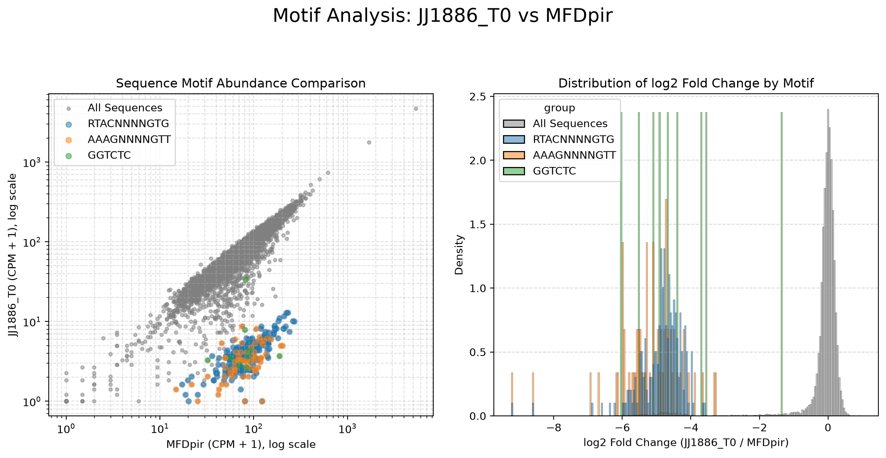
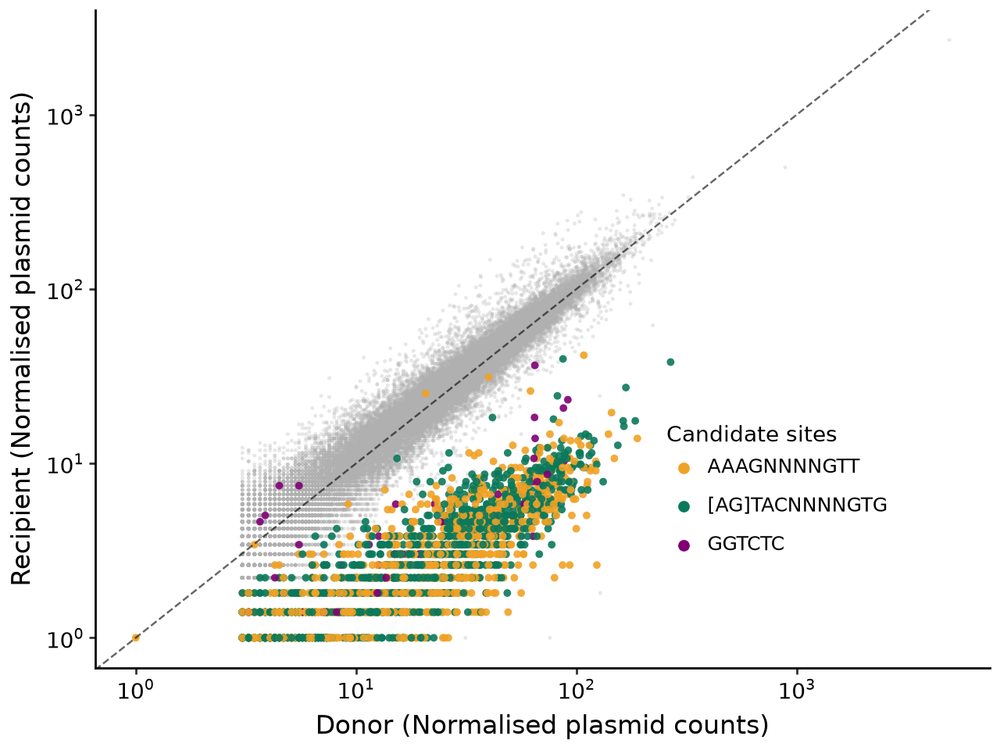

# Plotting


<!-- WARNING: THIS FILE WAS AUTOGENERATED! DO NOT EDIT! -->

## Reading a RandSeq result

Two plots, answering different questions.

[`plot_motif_analysis`](https://dbikard.github.io/randseq/plotting.html#plot_motif_analysis)
shows the whole library: donor against recipient counts, one point per
plasmid, with the carriers of each called motif highlighted, and beside
it the log2FC distribution of each motif’s carriers against all
plasmids. Plasmids absent from the recipient sit at y = 1, because a
pseudocount is added before the log. It answers *did this strain
restrict anything, and does each call look like one shifted population
rather than a handful of outliers*.

[`plot_motif_depletion`](https://dbikard.github.io/randseq/plotting.html#plot_motif_depletion)
takes motifs you supply instead of the ones the pipeline found: a motif
REBASE predicts for the strain, or one called in another strain. It
tests a specific hypothesis, including when the answer is that the motif
was not restricted.

Read either plot beside the result table, whose columns answer separate
questions:

- `q_value`: how sure we are that the carriers are depleted more than
  their `background` allows by chance — the depletion rate, in this
  sample, of plasmids with the same insert GC content. It grows with
  support, so a weak effect on many plasmids can be very significant.
- `fraction_depleted`: how strong the effect is, the share of carriers
  depleted. For a weak motif, compare it with `background` (with
  `all_motifs=True`).
- `bimodality` (with `all_motifs=True`): whether the carriers’ log2FC
  form one population or two. The row is flagged `bimodal` when they do
  (coefficient above 5/9) and one of the two groups is at background
  level: some carriers destroyed, others untouched, the signature of a
  motif that dilutes a different site.

The histogram shows log2FC as
[`calculate_log2fc`](https://dbikard.github.io/randseq/utils.html#calculate_log2fc)
returns it, median-normalised: the median plasmid is at 0, and the
pipeline’s default depletion threshold is at -0.5 on this axis.

------------------------------------------------------------------------

<a
href="https://github.com/dbikard/randseq/blob/main/randseq/plotting.py#L19"
target="_blank" style="float:right; font-size:smaller">source</a>

### plot_motif_analysis

Donor against recipient counts with each motif’s carriers highlighted,
beside their log2FC.

``` python
plot_motif_analysis(counts_df, sample_col, ref_col, motifs, left_context,
                    right_context, title_main=None, pseudocount=1,
                    log2fc_count_threshold=20, log2fc_pseudocount=1,
                    figsize=(12, 6), save_filename=None,
                    distribution_plot_log_xscale=False)
```

<table>
<colgroup>
<col style="width: 25%" />
<col style="width: 25%" />
<col style="width: 25%" />
<col style="width: 25%" />
</colgroup>
<thead>
<tr>
<th>Parameter</th>
<th>Type</th>
<th>Default</th>
<th>Description</th>
</tr>
</thead>
<tbody>
<tr>
<td><code>counts_df</code></td>
<td>DataFrame</td>
<td></td>
<td>read counts, one row per insert, one column per sample</td>
</tr>
<tr>
<td><code>sample_col</code></td>
<td>str</td>
<td></td>
<td>the recipient sample to plot</td>
</tr>
<tr>
<td><code>ref_col</code></td>
<td>str</td>
<td></td>
<td>the input-library column it is compared with</td>
</tr>
<tr>
<td><code>motifs</code></td>
<td>DataFrame | None</td>
<td></td>
<td>motifs to highlight, in a ‘motif’ column (<a
href="https://dbikard.github.io/randseq/core.html#find_restricted_motifs"><code>find_restricted_motifs</code></a>)</td>
</tr>
<tr>
<td><code>left_context</code></td>
<td>str</td>
<td></td>
<td>vector sequence 5’ of the insert</td>
</tr>
<tr>
<td><code>right_context</code></td>
<td>str</td>
<td></td>
<td>vector sequence 3’ of the insert</td>
</tr>
<tr>
<td><code>title_main</code></td>
<td>str | None</td>
<td><code>None</code></td>
<td>figure title; default “Motif Analysis: &lt;sample_col&gt; vs
&lt;ref_col&gt;”</td>
</tr>
<tr>
<td><code>pseudocount</code></td>
<td>float</td>
<td><code>1</code></td>
<td>added to the counts per million of the scatter, before the log</td>
</tr>
<tr>
<td><code>log2fc_count_threshold</code></td>
<td>int</td>
<td><code>20</code></td>
<td><code>count_threshold</code> of <a
href="https://dbikard.github.io/randseq/utils.html#calculate_log2fc"><code>calculate_log2fc</code></a>,
for the histogram</td>
</tr>
<tr>
<td><code>log2fc_pseudocount</code></td>
<td>float</td>
<td><code>1</code></td>
<td><code>pseudocount</code> of <a
href="https://dbikard.github.io/randseq/utils.html#calculate_log2fc"><code>calculate_log2fc</code></a>,
for the histogram</td>
</tr>
<tr>
<td><code>figsize</code></td>
<td>tuple</td>
<td><code>(12, 6)</code></td>
<td>figure size, in inches</td>
</tr>
<tr>
<td><code>save_filename</code></td>
<td>str | None</td>
<td><code>None</code></td>
<td>also save the figure to this file, at 300 dpi</td>
</tr>
<tr>
<td><code>distribution_plot_log_xscale</code></td>
<td>bool</td>
<td><code>False</code></td>
<td>log scale on the histogram’s x axis</td>
</tr>
<tr>
<td><em>returns</em></td>
<td>tuple</td>
<td></td>
<td><code>(fig, axes)</code>; <code>(None, None)</code> when
<code>counts_df</code> is empty or lacks either column</td>
</tr>
</tbody>
</table>

### Example: JJ1886 on the 20 nt library

`countsTable.csv.gz` is a run of the 20 nt library (11,629 inserts)
through 19 strains, with the donor `MFDpir` as reference. JJ1886 at the
default settings:

``` python
counts_file="countsTable.csv.gz"
file_path=os.path.join(data_path,counts_file)
counts=pd.read_csv(file_path, index_col=0)
counts = counts[[col for col in counts.columns if ("_T0" in col) or ("MFDpir" in col)]]

log2fc_df = calculate_log2fc(counts, reference_column='MFDpir', count_threshold=20, pseudocount=1)
```

``` python
left, right = "GTCCTAGGTATAATACTAGT", "GTTTTAGAGCTAGAAATAGC"
motifs = find_restricted_motifs(log2fc_df["JJ1886_T0"], left, right)
motifs
```

    667 candidate(s) across all patterns; 464 remain after step 3.
    158 candidate(s) that need the vector flanks, without enough internal sites (15 would otherwise be called).
    293 candidate(s) whose score was borrowed from a stronger one.
    28 motif(s) scored.
    1 degenerate site(s) reported as one motif:
      RTACNNNNGTG <- ATACNNNNGTG + CACNNNNGTAC
    3 motif(s) called.

    Scanning patterns:   0%|          | 0/43 [00:00<?, ?it/s]
    Scanning patterns:   2%|2         | 1/43 [00:00<00:10,  3.98it/s]
    Scanning patterns:  12%|#1        | 5/43 [00:00<00:02, 16.53it/s]
    Scanning patterns:  21%|##        | 9/43 [00:00<00:01, 23.37it/s]
    Scanning patterns:  30%|###       | 13/43 [00:00<00:01, 27.93it/s]
    Scanning patterns:  40%|###9      | 17/43 [00:00<00:00, 28.24it/s]
    Scanning patterns:  49%|####8     | 21/43 [00:00<00:00, 31.41it/s]
    Scanning patterns:  58%|#####8    | 25/43 [00:00<00:00, 33.72it/s]
    Scanning patterns:  67%|######7   | 29/43 [00:01<00:00, 29.62it/s]
    Scanning patterns:  77%|#######6  | 33/43 [00:01<00:00, 25.72it/s]
    Scanning patterns:  84%|########3 | 36/43 [00:01<00:00, 22.31it/s]
    Scanning patterns:  91%|######### | 39/43 [00:01<00:00, 22.78it/s]
    Scanning patterns:  98%|#########7| 42/43 [00:01<00:00, 22.67it/s]
    Scanning patterns: 100%|##########| 43/43 [00:01<00:00, 24.30it/s]

<div>
<style scoped>
    .dataframe tbody tr th:only-of-type {
        vertical-align: middle;
    }
&#10;    .dataframe tbody tr th {
        vertical-align: top;
    }
&#10;    .dataframe thead th {
        text-align: right;
    }
</style>

<table class="dataframe" data-quarto-postprocess="true" data-border="1">
<thead>
<tr style="text-align: right;">
<th data-quarto-table-cell-role="th"></th>
<th data-quarto-table-cell-role="th">motif</th>
<th data-quarto-table-cell-role="th">num_sequences</th>
<th data-quarto-table-cell-role="th">fraction_depleted</th>
<th data-quarto-table-cell-role="th">avg_log2fc</th>
<th data-quarto-table-cell-role="th">q_value</th>
</tr>
</thead>
<tbody>
<tr>
<td data-quarto-table-cell-role="th">0</td>
<td>RTACNNNNGTG</td>
<td>212</td>
<td>1.0</td>
<td>-4.850774</td>
<td>3.828852e-242</td>
</tr>
<tr>
<td data-quarto-table-cell-role="th">1</td>
<td>AAAGNNNNGTT</td>
<td>63</td>
<td>1.0</td>
<td>-5.209253</td>
<td>1.040810e-70</td>
</tr>
<tr>
<td data-quarto-table-cell-role="th">2</td>
<td>GGTCTC</td>
<td>9</td>
<td>1.0</td>
<td>-4.363412</td>
<td>1.867698e-08</td>
</tr>
</tbody>
</table>

</div>

``` python
fig, axes = plot_motif_analysis(counts, "JJ1886_T0", "MFDpir", motifs, left, right)
```



The three calls are JJ1886’s three RM sites: `AAAGNNNNGTT`, `GGTCTC`,
and `RTACNNNNGTG`, reported as one motif from its two variants,
`ATACNNNNGTG` and `GTACNNNNGTG` (the second read on the other strand,
`CACNNNNGTAC`). Every carrier is destroyed: `fraction_depleted` is 1.

`all_motifs=True` also returns the motifs scored but not called, 24
here. Thirteen would be calls but need the vector flank and lack
internal sites (`core`, *Sites completed by the flank*): `CACANNAGTA`
has 190 of its 192 carriers depleted, but 188 of them read part of it in
the flank, and its 4 internal carriers are too few to stand on. The rest
fail the bound on the depleted fraction: `CTTNCACA` has 10 of its 20
carriers depleted (q ≈ 10⁻⁴), which bounds the fraction at 0.30, short
of 0.5.

### Custom-motif depletion plot

Donor against recipient counts, coloured by motifs you supply. A plasmid
carrying several takes the colour of the last one in the list. Requires
`plotnine`: the function returns a `ggplot` rather than drawing it, so a
caller can add layers or save it at a set size,
`p.save(filename, width=6, height=5, units="in")`.

------------------------------------------------------------------------

<a
href="https://github.com/dbikard/randseq/blob/main/randseq/plotting.py#L155"
target="_blank" style="float:right; font-size:smaller">source</a>

### plot_motif_depletion

Log-log plot of one sample’s counts against the reference, coloured by
the motifs you name.

``` python
plot_motif_depletion(counts_df, sample_col, ref_col, motif_list, left_context,
                     right_context, pseudocount=1, palette=['#F0A226',
                     '#0A795B', '#800074'])
```

<table>
<colgroup>
<col style="width: 25%" />
<col style="width: 25%" />
<col style="width: 25%" />
<col style="width: 25%" />
</colgroup>
<thead>
<tr>
<th>Parameter</th>
<th>Type</th>
<th>Default</th>
<th>Description</th>
</tr>
</thead>
<tbody>
<tr>
<td><code>counts_df</code></td>
<td>DataFrame</td>
<td></td>
<td>read counts, one row per insert, one column per sample</td>
</tr>
<tr>
<td><code>sample_col</code></td>
<td>str</td>
<td></td>
<td>the recipient sample to plot</td>
</tr>
<tr>
<td><code>ref_col</code></td>
<td>str</td>
<td></td>
<td>the input-library column it is compared with</td>
</tr>
<tr>
<td><code>motif_list</code></td>
<td>list</td>
<td></td>
<td>motifs to colour by, in IUPAC letters and/or bracketed classes</td>
</tr>
<tr>
<td><code>left_context</code></td>
<td>str</td>
<td></td>
<td>vector sequence 5’ of the insert</td>
</tr>
<tr>
<td><code>right_context</code></td>
<td>str</td>
<td></td>
<td>vector sequence 3’ of the insert</td>
</tr>
<tr>
<td><code>pseudocount</code></td>
<td>float</td>
<td><code>1</code></td>
<td>added to the counts per million, before the log</td>
</tr>
<tr>
<td><code>palette</code></td>
<td>list</td>
<td><code>['#F0A226', '#0A795B', '#800074']</code></td>
<td>one colour per motif, at least as many as
<code>motif_list</code></td>
</tr>
</tbody>
</table>

### Example: JJ1886 on the 150 nt panel

`counts_panel.csv.gz` holds UMI counts for eight strains in duplicate
and the `Control` input library (`counts_panel_key.csv` says what each
strain shows), flanked by the contexts below. The calls use the
defaults: log2FC median-normalised by
[`calculate_log2fc`](https://dbikard.github.io/randseq/utils.html#calculate_log2fc),
a plasmid counted as depleted at log2FC \< -0.5, and a motif kept when
at least half of its carriers are depleted (score ≥ 0.5).

``` python
counts_panel = pd.read_csv(os.path.join(data_path, "counts_panel.csv.gz"), index_col=0)
left_panel, right_panel = "GTCTAGGGCGGCGGTAAAAC", "ACTAGAGCACCAGAAGTCTA"
log2fc_panel = calculate_log2fc(counts_panel, reference_column="Control_R1", count_threshold=20, pseudocount=1)
log2fc_panel.describe()
```

<div>
<style scoped>
    .dataframe tbody tr th:only-of-type {
        vertical-align: middle;
    }
&#10;    .dataframe tbody tr th {
        vertical-align: top;
    }
&#10;    .dataframe thead th {
        text-align: right;
    }
</style>

<table class="dataframe" data-quarto-postprocess="true" data-border="1">
<thead>
<tr style="text-align: right;">
<th data-quarto-table-cell-role="th"></th>
<th data-quarto-table-cell-role="th">Control_R2</th>
<th data-quarto-table-cell-role="th">JJ1886_R1</th>
<th data-quarto-table-cell-role="th">JJ1886_R2</th>
<th data-quarto-table-cell-role="th">CFT073_R1</th>
<th data-quarto-table-cell-role="th">CFT073_R2</th>
<th data-quarto-table-cell-role="th">HS_R1</th>
<th data-quarto-table-cell-role="th">HS_R2</th>
<th data-quarto-table-cell-role="th">LMR_503_R1</th>
<th data-quarto-table-cell-role="th">LMR_503_R2</th>
<th data-quarto-table-cell-role="th">B156_R1</th>
<th data-quarto-table-cell-role="th">B156_R2</th>
<th data-quarto-table-cell-role="th">381A_R1</th>
<th data-quarto-table-cell-role="th">381A_R2</th>
<th data-quarto-table-cell-role="th">EDL933_R1</th>
<th data-quarto-table-cell-role="th">EDL933_R2</th>
<th data-quarto-table-cell-role="th">EDL933_dRM_R1</th>
<th data-quarto-table-cell-role="th">EDL933_dRM_R2</th>
</tr>
</thead>
<tbody>
<tr>
<td data-quarto-table-cell-role="th">count</td>
<td>30108.000000</td>
<td>3.010800e+04</td>
<td>30108.000000</td>
<td>30108.000000</td>
<td>30108.000000</td>
<td>30108.000000</td>
<td>30108.000000</td>
<td>30108.000000</td>
<td>30108.000000</td>
<td>30108.000000</td>
<td>3.010800e+04</td>
<td>30108.000000</td>
<td>30108.000000</td>
<td>30108.000000</td>
<td>3.010800e+04</td>
<td>30108.000000</td>
<td>3.010800e+04</td>
</tr>
<tr>
<td data-quarto-table-cell-role="th">mean</td>
<td>-0.092785</td>
<td>-1.928490e-01</td>
<td>-0.235595</td>
<td>-0.027408</td>
<td>-0.100585</td>
<td>0.013360</td>
<td>-0.086414</td>
<td>-0.167986</td>
<td>-0.203716</td>
<td>-0.131418</td>
<td>-1.488361e-01</td>
<td>-0.008703</td>
<td>0.040885</td>
<td>0.005516</td>
<td>-7.569209e-02</td>
<td>0.016939</td>
<td>-8.404360e-02</td>
</tr>
<tr>
<td data-quarto-table-cell-role="th">std</td>
<td>0.662484</td>
<td>9.257199e-01</td>
<td>0.980291</td>
<td>0.584757</td>
<td>0.841629</td>
<td>0.548044</td>
<td>0.878549</td>
<td>0.985485</td>
<td>1.040806</td>
<td>0.823174</td>
<td>8.363603e-01</td>
<td>1.140848</td>
<td>1.403861</td>
<td>0.505451</td>
<td>7.503933e-01</td>
<td>0.477549</td>
<td>9.469204e-01</td>
</tr>
<tr>
<td data-quarto-table-cell-role="th">min</td>
<td>-4.602036</td>
<td>-7.591883e+00</td>
<td>-7.471095</td>
<td>-6.797323</td>
<td>-7.173709</td>
<td>-7.462027</td>
<td>-7.930737</td>
<td>-6.886132</td>
<td>-7.352450</td>
<td>-6.642861</td>
<td>-5.341084e+00</td>
<td>-5.498806</td>
<td>-4.891134</td>
<td>-8.484900</td>
<td>-7.952919e+00</td>
<td>-7.982994</td>
<td>-7.284022e+00</td>
</tr>
<tr>
<td data-quarto-table-cell-role="th">25%</td>
<td>-0.155492</td>
<td>-2.366480e-01</td>
<td>-0.302307</td>
<td>-0.334449</td>
<td>-0.223882</td>
<td>-0.244978</td>
<td>-0.250706</td>
<td>-0.360724</td>
<td>-0.347019</td>
<td>-0.257186</td>
<td>-3.349095e-01</td>
<td>-0.672200</td>
<td>-0.883312</td>
<td>-0.251691</td>
<td>-2.594316e-01</td>
<td>-0.235059</td>
<td>-4.701161e-01</td>
</tr>
<tr>
<td data-quarto-table-cell-role="th">50%</td>
<td>0.000000</td>
<td>-3.469447e-18</td>
<td>0.000000</td>
<td>0.000000</td>
<td>0.000000</td>
<td>0.000000</td>
<td>0.000000</td>
<td>0.000000</td>
<td>0.000000</td>
<td>0.000000</td>
<td>-8.673617e-19</td>
<td>0.000000</td>
<td>0.000000</td>
<td>0.000000</td>
<td>6.938894e-18</td>
<td>0.000000</td>
<td>-1.387779e-17</td>
</tr>
<tr>
<td data-quarto-table-cell-role="th">75%</td>
<td>0.154173</td>
<td>2.150265e-01</td>
<td>0.252766</td>
<td>0.302789</td>
<td>0.224322</td>
<td>0.251669</td>
<td>0.251436</td>
<td>0.321928</td>
<td>0.315946</td>
<td>0.254159</td>
<td>2.931217e-01</td>
<td>0.649093</td>
<td>0.929936</td>
<td>0.259469</td>
<td>2.641303e-01</td>
<td>0.249652</td>
<td>4.400626e-01</td>
</tr>
<tr>
<td data-quarto-table-cell-role="th">max</td>
<td>1.404808</td>
<td>2.108241e+00</td>
<td>2.176589</td>
<td>2.610762</td>
<td>2.723555</td>
<td>3.356025</td>
<td>3.096185</td>
<td>3.392317</td>
<td>3.375307</td>
<td>2.850857</td>
<td>3.761570e+00</td>
<td>6.309287</td>
<td>6.175992</td>
<td>2.793549</td>
<td>2.605639e+00</td>
<td>2.461265</td>
<td>3.302067e+00</td>
</tr>
</tbody>
</table>

</div>

``` python
motifs_jj1886 = find_restricted_motifs(log2fc_panel["JJ1886_R1"], left_panel, right_panel)
motifs_jj1886
```

    85 candidate(s) across all patterns; 4 remain after step 3.
    4 motif(s) scored.
    1 degenerate site(s) reported as one motif:
      RTACNNNNGTG <- ATACNNNNGTG + CACNNNNGTAC
    3 motif(s) called.

    Scanning patterns:   0%|          | 0/43 [00:00<?, ?it/s]
    Scanning patterns:   5%|4         | 2/43 [00:00<00:03, 12.76it/s]
    Scanning patterns:   9%|9         | 4/43 [00:00<00:03, 10.89it/s]
    Scanning patterns:  14%|#3        | 6/43 [00:00<00:03, 10.66it/s]
    Scanning patterns:  19%|#8        | 8/43 [00:00<00:04,  8.71it/s]
    Scanning patterns:  21%|##        | 9/43 [00:00<00:03,  8.92it/s]
    Scanning patterns:  26%|##5       | 11/43 [00:01<00:03,  9.84it/s]
    Scanning patterns:  30%|###       | 13/43 [00:01<00:03,  9.51it/s]
    Scanning patterns:  35%|###4      | 15/43 [00:01<00:03,  9.32it/s]
    Scanning patterns:  37%|###7      | 16/43 [00:01<00:03,  8.65it/s]
    Scanning patterns:  40%|###9      | 17/43 [00:01<00:03,  7.86it/s]
    Scanning patterns:  42%|####1     | 18/43 [00:02<00:03,  7.60it/s]
    Scanning patterns:  47%|####6     | 20/43 [00:02<00:02,  9.00it/s]
    Scanning patterns:  49%|####8     | 21/43 [00:02<00:02,  8.62it/s]
    Scanning patterns:  53%|#####3    | 23/43 [00:02<00:02,  9.04it/s]
    Scanning patterns:  56%|#####5    | 24/43 [00:02<00:02,  8.76it/s]
    Scanning patterns:  60%|######    | 26/43 [00:02<00:01, 10.12it/s]
    Scanning patterns:  65%|######5   | 28/43 [00:02<00:01, 11.45it/s]
    Scanning patterns:  70%|######9   | 30/43 [00:03<00:01, 11.33it/s]
    Scanning patterns:  74%|#######4  | 32/43 [00:03<00:00, 11.46it/s]
    Scanning patterns:  79%|#######9  | 34/43 [00:03<00:00, 11.44it/s]
    Scanning patterns:  84%|########3 | 36/43 [00:03<00:00, 10.48it/s]
    Scanning patterns:  88%|########8 | 38/43 [00:03<00:00,  9.87it/s]
    Scanning patterns:  93%|#########3| 40/43 [00:04<00:00,  8.91it/s]
    Scanning patterns:  95%|#########5| 41/43 [00:04<00:00,  8.86it/s]
    Scanning patterns: 100%|##########| 43/43 [00:04<00:00,  8.65it/s]
    Scanning patterns: 100%|##########| 43/43 [00:04<00:00,  9.45it/s]

<div>
<style scoped>
    .dataframe tbody tr th:only-of-type {
        vertical-align: middle;
    }
&#10;    .dataframe tbody tr th {
        vertical-align: top;
    }
&#10;    .dataframe thead th {
        text-align: right;
    }
</style>

<table class="dataframe" data-quarto-postprocess="true" data-border="1">
<thead>
<tr style="text-align: right;">
<th data-quarto-table-cell-role="th"></th>
<th data-quarto-table-cell-role="th">motif</th>
<th data-quarto-table-cell-role="th">num_sequences</th>
<th data-quarto-table-cell-role="th">fraction_depleted</th>
<th data-quarto-table-cell-role="th">avg_log2fc</th>
<th data-quarto-table-cell-role="th">q_value</th>
</tr>
</thead>
<tbody>
<tr>
<td data-quarto-table-cell-role="th">0</td>
<td>AAAGNNNNGTT</td>
<td>913</td>
<td>0.997809</td>
<td>-3.425663</td>
<td>0.000000e+00</td>
</tr>
<tr>
<td data-quarto-table-cell-role="th">1</td>
<td>RTACNNNNGTG</td>
<td>963</td>
<td>1.000000</td>
<td>-3.285517</td>
<td>0.000000e+00</td>
</tr>
<tr>
<td data-quarto-table-cell-role="th">2</td>
<td>GGTCTC</td>
<td>55</td>
<td>0.981818</td>
<td>-2.851532</td>
<td>2.999895e-43</td>
</tr>
</tbody>
</table>

</div>

``` python
fig, axes = plot_motif_analysis(counts_panel, "JJ1886_R1", "Control_R1", motifs_jj1886, left_panel, right_panel)
```


The same comparison for motifs you name, without running the search:
here JJ1886’s three RM sites as REBASE gives them. `[AG]` and the IUPAC
`R` are equivalent.

``` python
jj1886_motifs = ["AAAGNNNNGTT", "[AG]TACNNNNGTG", "GGTCTC"]  # JJ1886's RM sites
p = plot_motif_depletion(counts_panel, "JJ1886_R1", "Control_R1", jj1886_motifs, left_panel, right_panel)
p
```


